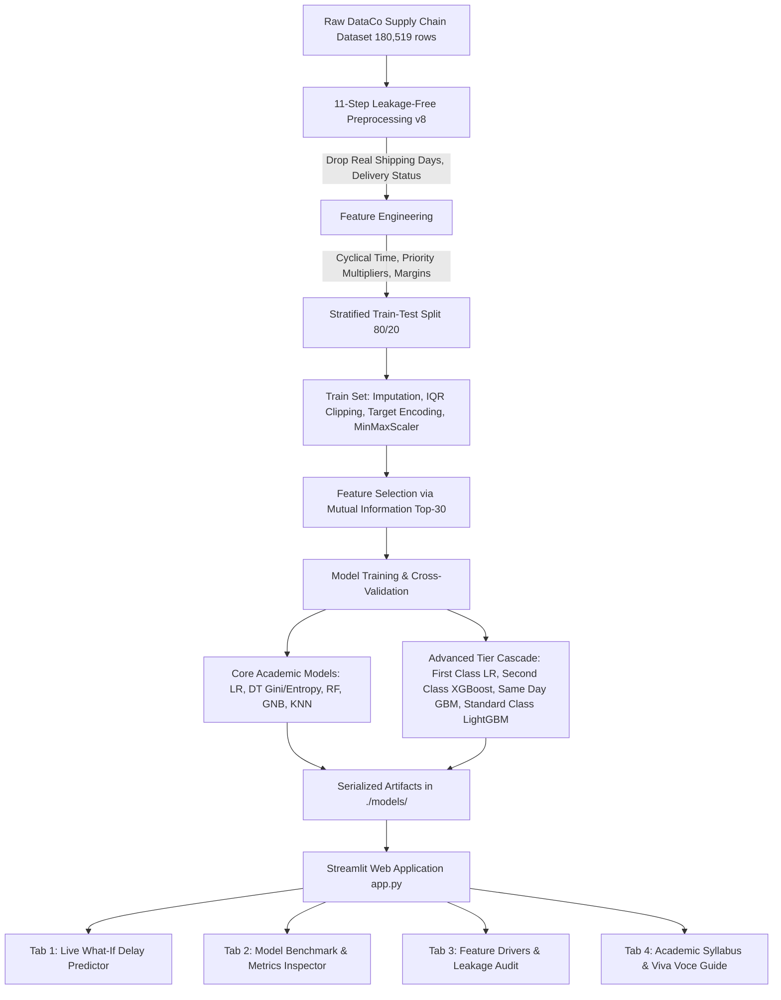

# 📦 Delivery Delay Prediction — Supply Chain ML & Interactive Dashboard

[](https://www.python.org/)
[](https://streamlit.io/)
[](https://scikit-learn.org/)
[](LICENSE)
[](#)

A machine learning system and interactive **Streamlit Web Application** that predicts whether a supply chain delivery will be **On-Time**, **At-Risk**, or **Delayed** — built on the DataCo Smart Supply Chain dataset (180,519 records) augmented with weather and logistics data.

---

## 🔍 The Core Problem

A naive global model trained on this dataset achieves ~80% accuracy but **fails badly on certain shipping tiers** — Standard Class produces an F1-score of just 0.04 for the delay class under naive baselines. The reason: class imbalance in `Late_delivery_risk` is **conditional on Shipping Mode, not global**.

- **First Class** → ~95% of orders are late (majority is late)
- **Second Class** → ~76% late (moderate imbalance)
- **Same Day** → ~46% late (near balanced)
- **Standard Class** → ~38% late (delay is the minority — 59% of all data)

A single unweighted model lumps these together, creating a late-biased decision boundary that works well for First Class but misses Standard Class delays. This project provides both an **interactive Streamlit operations dashboard**, **pure syllabus-aligned baseline benchmarks (Course: UML501)**, and a **Tier-Specific Cascade Classifier** solving conditional imbalance.

---

## 🏗️ Architecture Overview



---

## ⚙️ Preprocessing Pipeline (11 Steps, Leakage-Free)

All statistics are computed **on the training set only** and applied identically to the test set. The test set is never snooped on during any preprocessing step.

| Step | What It Does | Why |
|---|---|---|
| **Load & Clean** | Drop leakage columns (`Days for shipping (real)`, `Delivery Status`, `Order Status`, etc.) | These are post-hoc labels that directly leak the target |
| **Feature Engineering** | Create new features from existing data (row-level only) | Safe to create before the split — no global statistics used |
| **Train/Test Split** | 80/20 stratified by target | Everything after this is strictly fit on train only |
| **Imputation** | Mean (numeric) / mode (categorical) — train stats only | Fills NaN without leaking test information |
| **Outlier Capping** | IQR bounds ($1.5 \times \text{IQR}$) computed on train | Winsorises extremes, preserves row count |
| **Geo Feature** | Distance from geographic centroid (`dist_center` using train median) | Geographic remoteness signal without leakage |
| **Log Transform** | `log1p` for features with skewness $> 0.5$ | Compresses right-skewed distributions (Sales, Profit, Discount) |
| **Encoding** | OHE for $< 5$ unique values; Target Encoding (smoothing=10) for $\ge 5$ | Prevents dimension explosion on high-cardinality features |
| **Normalize** | `MinMaxScaler` fit on train $\to [0, 1]$ | Required for distance/linear models; prevents scale dominance |
| **Feature Reduction** | 3-stage: near-zero variance $\to$ collinearity ($r > 0.85$) $\to$ Mutual Info | Removes noise and prevents overfitting |
| **Confidence Output** | Margin filtering ($\pm 0.10$ around decision threshold) | Flags borderline cases for human logistics escalation |

### **Feature Engineering Highlights**
- `order_month`, `order_dayofweek`: Extracted from order date for seasonal delivery patterns.
- `month_sin/cos`, `dow_sin/cos`: Cyclical continuous encodings (December $\to$ January is continuous).
- `is_weekend`: Operational flag for reduced weekend transit bandwidth.
- `ship_priority`: Ordinal priority mapping (`Standard: 1`, `Second: 2`, `First: 3`, `Same Day: 4`).
- `sched_x_priority`: Interaction feature (`scheduled_days` $\times$ `ship_priority`).
- `price_per_item`: Sales divided by item quantity.
- `profit_margin`: Ratio of benefit per order to sales.
- `discount_ratio`: Order item discount relative to product price.

---

## 🤖 Models & Evaluation

### 1. Core Academic Models (Course UML501: Machine Learning)
Evaluated across standard classification metrics:

| Model | Std Accuracy | Conf Accuracy ($\pm 0.10$) | Precision | Recall (Sensitivity) | Specificity | F1-Score | ROC-AUC |
|---|:---:|:---:|:---:|:---:|:---:|:---:|:---:|
| **Random Forest** 🏆 | **71.61%** | **77.14%** | **76.32%** | 69.93% | **73.66%** | **72.98%** | **0.7955** |
| **XGBoost** | 70.97% | 75.67% | 75.24% | 70.14% | 71.98% | 72.60% | 0.7889 |
| **Cascade Classifier** | 70.61% | 76.41% | 72.50% | **74.75%** | 65.59% | 73.61% | 0.7943 |
| **Decision Tree (Gini)** | 70.06% | 73.59% | 74.30% | 69.39% | 70.87% | 71.76% | 0.7727 |
| **K-NN ($k=9$)** | 68.95% | 73.69% | 73.18% | 69.69% | 68.02% | 71.40% | 0.7602 |
| **Logistic Regression** | 68.46% | 73.90% | 72.73% | 67.95% | 69.07% | 70.26% | 0.7545 |
| **Gaussian Naive Bayes** | 67.84% | 70.19% | 73.51% | 64.64% | 71.73% | 68.79% | 0.7201 |

### 2. Tier-Specific Cascade Classifier
Addresses tier-conditional imbalance by routing each shipping tier to a specialized estimator:

| Tier | Model | Strategy |
|---|---|---|
| **First Class** | Logistic Regression ($C=10$) | High late rate (~95%) — linear boundary sufficient |
| **Second Class** | XGBoost (`scale_pos_weight=3.3`) | Moderate imbalance — penalizes missed on-time predictions |
| **Same Day** | Gradient Boosting (`max_depth=3`) | Smaller partition (~2k rows) — shallow trees prevent overfitting |
| **Standard Class** | LightGBM (`is_unbalance=True` + OOF threshold) | Largest tier (59% of data), delay is minority — tuned boundary |

---

## 🎯 Confidence-Based Evaluation (Selective Classification)

Rather than forcing every prediction to a hard 0 or 1, each model outputs a probability. Predictions within **$\pm 0.10$ of the decision boundary** are flagged as **At-Risk** for human logistics review:

```
P(Late) < 0.40           → Confident On-Time  ✅  (Automated flow)
0.40 ≤ P(Late) < 0.60   → At-Risk            ⚠️  (Flagged for human review)
P(Late) ≥ 0.60           → Confident Late     🔴  (Trigger expedited dispatch)
```

This prevents catastrophic errors on uncertain orders and increases high-confidence prediction accuracy up to **77.14%**.

---

## 📁 Repository Structure

```
delivery-delay-prediction/
├── app.py                      # Interactive Streamlit Web Application
├── train_models.py             # End-to-end training & artifact export pipeline
├── simple_models.py            # Standalone syllabus-pure benchmark script (~2s execution)
├── requirements.txt            # Project dependencies
├── .gitignore                  # Git ignore rules for Python, Streamlit & cache
├── README.md                   # Comprehensive project documentation
├── LICENSE                     # MIT Open Source License
├── models/                     # Serialized pre-trained artifacts for instant UI launch
│   ├── all_models.joblib       # 7 trained classifiers (LR, DT, RF, GNB, KNN, XGB, Cascade)
│   ├── pipeline_metadata.joblib # Feature names, imputation statistics, MinMax scaler
│   ├── eval_results.json       # Exact benchmark metrics table
│   ├── feature_importance.json # Top predictive feature drivers
│   ├── roc_curves.json         # ROC curve coordinates for charting
│   └── test_sample.csv         # 100-order sample for live prediction simulation
├── notebooks/                  # Exploratory data science notebooks
│   └── final.ipynb             # Research notebook covering v8 pipeline & cascade experiments
├── reports/                    # Academic presentations & reports
│   └── report.pdf              # Comprehensive project report
└── data/                       # Dataset directory (raw CSVs ignored via .gitignore)
    └── README.md               # Data download & setup instructions
```

---

## 🚀 Quickstart & Installation


### 1. Set Up Virtual Environment
```bash
# Windows
python -m venv venv
.\venv\Scripts\activate

# macOS / Linux
python3 -m venv venv
source venv/bin/activate
```

### 3. Install Dependencies
```bash
pip install -r requirements.txt
```

### 4. Run the Interactive Streamlit App
```bash
streamlit run app.py
```
Open `http://localhost:8501` in your browser.

---

## 🖥️ Streamlit Web App Walkthrough

1. **🔮 Live Delay Predictor (What-If Analysis):**
   - Configure shipping tiers, scheduled days, sales value, profit, quantity, and discount.
   - Select any classifier model and adjust decision thresholds and confidence margin bands.
   - Receive instant predictions: **🟢 LOW RISK (ON-TIME)** vs. **🔴 HIGH RISK (DELAY)** with probability gauges and operational recommendations.
   - Includes a sample loader to test real ground-truth test orders from the dataset.
2. **📊 Model Comparison & Metrics:**
   - Full comparative table across 10 evaluation metrics.
   - Bar chart comparing standard accuracy against confidence-filtered accuracy.
   - Interactive confusion matrix inspector breaking down TN, FP, FN, and TP.
3. **🔍 Feature Importance & Leakage Prevention:**
   - Horizontal bar chart ranking the top features driving shipment delays.
   - Clear audit of why `Days for shipping (real)` and `Delivery Status` constitute data leakage.
4. **🎓 Academic Syllabus & Viva Voce Guide:**
   - Mapping to the **UML501: Machine Learning** syllabus.
   - Curated model answers for common external examiner viva questions.
   - LaTeX-rendered formula cheat-sheet (Gini Impurity, Entropy, Sigmoid, Bayes Theorem, F1-Score).

---

## 📚 Syllabus Alignment (Course UML501: Machine Learning)

| Unit / Module | Syllabus Topic | Project Implementation |
|---|---|---|
| **Unit 2: Data Pre-processing** | Data Cleaning, Scaling, Splitting, Reduction | Leakage removal, MinMax normalization, 80/20 train-test split, Mutual Information top-30 feature selection. |
| **Unit 4: Classification** | Logistic Regression | Evaluated as a baseline linear probabilistic classifier ($68.46\%$ Acc). |
| **Unit 4: Classification** | Decision Tree (Gini & Entropy) | CART Decision Tree with depth pruning; Gini vs. Information Gain comparison ($70.06\%$ Acc). |
| **Unit 4: Classification** | Random Forest Classification | 100-tree bagging ensemble with random feature subspace (**Top Performer: $71.61\%$ Std / $77.14\%$ Conf Acc**). |
| **Unit 4: Classification** | Naive Bayes Algorithm | Gaussian Naive Bayes modeling conditional feature likelihood ($67.84\%$ Acc). |
| **Unit 4: Classification** | K-Nearest Neighbours (K-NN) | Distance-based instance classifier using $k=9$ neighbors ($68.95\%$ Acc). |
| **Unit 4: Performance Evaluation** | Metrics & Confusion Matrix | Sensitivity (Recall), Specificity, Precision, F1-Score, ROC-AUC, and Confusion Matrix breakdown. |

---


## 📄 License

This project is open-source and available under the [MIT License](LICENSE).
